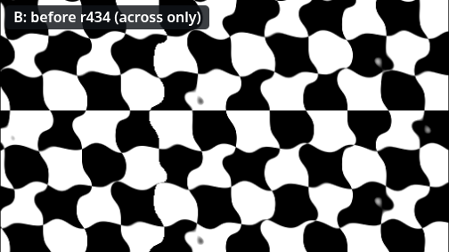
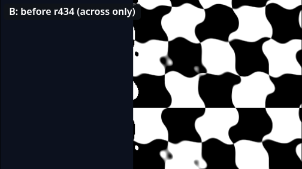
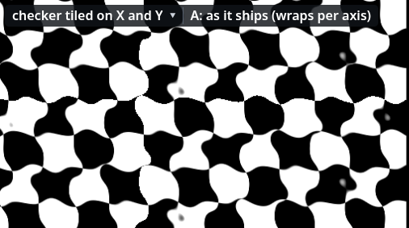
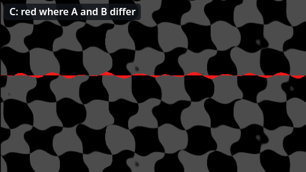

# Where the sea ends: teaching SWELL which edges to wrap

*Dev post, 16 October 2026. Parallax Background 2026, the SWELL effect (r431, r434).*

SWELL is the newest of the library's shader effects. It moves the painted crests of a sea with two crossing waves
that travel at different speeds, so the water rolls instead of sliding. It shipped in r431, in all three readers
(libGDX, including the browser build, Godot and jMonkeyEngine), and the beach page it was made for looked right
straight away. Then we tried it on a checkerboard, and every tile edge on Y had a flat band across it.

## How SWELL draws a pixel

Most effects change a pixel's colour. SWELL changes *where the pixel is read from*. For every pixel of the layer it
works out how far the two waves have pushed the water at that spot (up to the amplitude sideways, half of it up and
down) and reads the image there instead.

Near the middle of the image that's all there is to it. Near an edge, the spot it wants can be *outside* the image:
a few pixels past the left side, or past the top. Something has to decide what is there. A shader has two cheap
answers:

- **Wrap**: carry on from the opposite side (`fract`). Past the right edge you read the left edge, as if the image
  were tiled. That's right when the image *is* tiled, because the next tile really does start with the left edge.
- **Hold**: stay on the last row or column (`clamp`). Past the top you keep reading the top row. Nothing comes from
  the far side, but the edge row gets stretched over the strip the wave wanted.

The first SWELL used one fixed rule: wrap across, hold up and down. That's exactly right for a sea, which repeats
sideways and never vertically. It's wrong on any other page.

## What the fixed rule did

On a page tiled on Y, the image's top row sits against the bottom row of the tile above it. Holding there means the
wave stops at every tile edge: for a strip as tall as half the amplitude, every column reads the same edge row. That
gives a band of straight, unwaved pixels across the whole layer, once per tile.



On a page that does *not* repeat on X, wrapping made the opposite mistake: at each side, up to an amplitude's width of
the image's other side came in, even though no tile was there.



## Seeing it before choosing

Our first question about this got the honest answer "I see no difference, we need a lab". At normal zoom and the
sea's soft amplitude, the band is a couple of pixels of water that happens to be still. So we built one: the SWELL
edges lab draws the same page three times with the real reader (compiled to JavaScript, as a browser game runs it).
It shows SWELL with each rule, plus a third panel painted red wherever the two disagree. It opens zoomed three times
on the edge, scrolling up so the tile edges cross the view, with a choice of the checker tiled on X and Y, on Y only,
on neither, on X only, or the beach sea as it ships.

On the sea the red panel is empty, so both rules agree there. On every other page the red sits exactly on the tile
edges. That settled it.

## The rule now

SWELL now **wraps on the axes the page repeats on and holds on the others.** The reader already knows which axes its
page repeats on, so it hands them to the effects every frame (`LayerEffects.setRepeat`). The shader picks per axis
with one line:

```glsl
vec2 f = mix(clamp(l / u_size, 0.0, 1.0), fract(l / u_size), u_wrap);
```

`u_wrap` is 1 on an axis that repeats and 0 on one that doesn't. That line is written three times: in libGDX's GLSL,
in Godot's shading language, and in jME's material (`m_Wrap`). When nothing sets it (a game drawing through the
effects without the reader), it keeps the old behaviour, wrapping across and holding up and down, so nothing that
worked before changes under anyone's feet.





## Proving it, three times over

Each effect in this library is written three times, so each change is checked three times. The shaders round, the
set of scenes every reader renders and compares against libGDX, got a new scene, `s11`: the checker through SWELL,
a quarter of the world wide, tiled on X and Y and scrolled up so tile edges keep crossing the view. Godot and jME
both match libGDX on it to well under a tenth of a grey level.

A round only proves something if it fails when the thing is wrong. So a mutation script puts the old rule back, one
engine at a time, and in a second pass leaves the rule right but never hands it the page's repeat. All four mutants
fail the round at 6.4/255 on the mean, three times the gate.

## What it does not fix

Wrapping is only right where the next tile really starts with the opposite edge. Mirrored copies, padding between
tiles, and trimmed atlas regions still meet a neighbour that isn't the image's other side, and SWELL can still show a
seam there. Where SWELL holds, it still stretches the edge row over the strip the wave wanted, which is now visible
only on a side with no tile next to it. And WAVE, the older ripple, keeps its own rule (it holds sideways); nobody has
asked for it to change.

For the sea, nothing moved: it was right all along. For everything else that might be painted under SWELL (a rippling
wall of water, a waterfall tiled down the screen, a flag tiled both ways), the edges now behave like the page they
are in.
